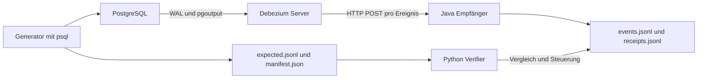

# Debezium Versuchsaufbau für Entwickler

[Schweizerdeutsch](entwicklerleitfaden-sg.md)

Für Cyrille. Stand: 11. Oktober 2026.

Der Versuchsaufbau untersucht PostgreSQL → Debezium Server → HTTP-Empfänger: Welche Zeilenänderungen kommen an, was steht in den Nachrichten, und wie geht es nach einem Ausfall weiter? Die vorhandenen Tests liefern dafür einen Ausgangspunkt. Für Aussagen über Produktionslasten braucht es eigene Messungen.

## Aufbau und Installation



Es gibt keinen Kafka-Broker. Debezium Server betreibt den PostgreSQL-Connector als eingebettete Engine und verwendet direkt einen HTTP-Sink. Ebenso enthält der Aufbau keine Oracle- oder PeopleSoft-Komponenten. Oracle Linux 8 bezeichnet hier das Betriebssystem eines möglichen Zielhosts, nicht die Quelldatenbank.

`make up` baut zuerst den Empfänger und startet anschliessend drei Dienste. Der Docker-Build verwendet Maven, kompiliert Java 25, führt die sechs Empfängertests aus und erstellt das Runtime-Image. Java und Maven müssen daher nicht auf dem Host installiert sein. Beim ersten Build werden Images und Maven-Abhängigkeiten aus dem Internet benötigt.

| Dienst | Funktion | Zustand und Zugriff |
|---|---|---|
| `postgres` | Quelldatenbank `appdb`, logische Replikation mit `pgoutput` | Volume `dbzproof_pg_data`; Hostport aus `PG_HOST_PORT` (Standard 5432) |
| `debezium` | Initialer Snapshot, danach WAL-basierte Änderungserfassung und HTTP-Zustellung | Volume `dbzproof_debezium_data` für `offsets.dat`; Health auf Hostport aus `DEBEZIUM_HOST_PORT` (Standard 8081) |
| `receiver` | `POST /events`, `GET /health`; Speicherung und Empfangsdiagnostik | Bind-Mount `logs/`; Hostport aus `RECEIVER_HOST_PORT` (Standard 8080) |
| `generator` | Manuell gestartetes SQL-Szenario; schreibt Erwartungen und Manifest | Compose-Profil `tools`; Bind-Mount `runs/` |

Alle veröffentlichten Ports sind an `127.0.0.1` gebunden. Die Zugangsdaten `dbz` / `dbz` sind lokale Demonstrationsdaten mit Superuser-Rechten. HTTP besitzt weder TLS noch Authentifizierung. Für diesen Versuch reicht das. Für ein produktives System wäre es zu wenig.

Beim **ersten Start einer leeren Datenbank** führt das PostgreSQL-Image die Dateien in `postgres/init/` aus:

1. `10-schema.sql` erstellt die Schemas `timecritical` und `bulk`, Tabellen, Schlüssel und Fremdschlüssel. Die drei erfassten Tabellen erhalten `REPLICA IDENTITY FULL`.
2. `20-seed.sql` legt 3 Kunden, 4 Bestellungen und 8 Bestellpositionen sowie separate Bulk-Daten an.
3. `30-replication.sql` erstellt `dbz_publication` für die drei Tabellen im Schema `timecritical`.

PostgreSQL startet mit `wal_level=logical`. Debezium verwendet den Slot `dbz_slot`, die Publication `dbz_publication`, einen Schema- und einen Tabellenfilter. Änderungen im Schema `bulk` sind ausgeschlossen. Mit `snapshot.mode=initial` werden zunächst die vorhandenen erfassten Zeilen gelesen; danach läuft die Erfassung aus dem WAL weiter. Der Slot hält die für seinen Konsumenten benötigte WAL-Historie vor. Bei längerem Stillstand kann diese Retention entsprechend Plattenplatz beanspruchen.

Die SQL-Initialisierung läuft bei einem normalen Neustart **nicht nochmals**. Änderungen an `postgres/init/` verändern eine bereits bestehende Datenbank deshalb nicht automatisch.

## Start und reproduzierbare Ausgangslage

Auf einem verbundenen Linux-Host beziehungsweise in WSL werden Docker CE, ein Compose-Plugin mit `up --wait`, Bash, Make, curl und Python 3.12 benötigt. Der Verifier verwendet nur die Python-Standardbibliothek. Das ausführende Konto muss Docker ohne ein zusätzliches `sudo` aufrufen können.

Alle folgenden Befehle laufen im Repository-Verzeichnis:

```sh
sed -i "s/^HOST_UID=.*/HOST_UID=$(id -u)/" .env
sed -i "s/^HOST_GID=.*/HOST_GID=$(id -g)/" .env
docker compose --profile tools config --quiet
make up
make health
make verify
```

`logs/` und `runs/` müssen für diese UID/GID schreibbar sein. Die in `.env` gesetzten Hostports müssen frei sein (Standard: 5432, 8080 und 8081). `make health` und der Verifier verwenden die aufgelösten Compose-Portwerte. Nach einer Portänderung die Dienste mit `docker compose up -d --wait --no-build postgres receiver debezium` neu erstellen; `restart` übernimmt die Änderung nicht. Offline zusätzlich `--pull never` verwenden. Die Versionspins stehen in `.env`.

Für einen erneuten vollständigen Test mit derselben Snapshot-Fixture braucht es eine leere Datenbank, leere Offsets und frische Logs. Vorher gewünschte Belege ausserhalb von `logs/` und `runs/` sichern:

```sh
# DESTRUKTIV: löscht nur den Zustand dieses Compose-Projekts.
make reset
make up
make verify
```

`make reset` entfernt Container, die Volumes `dbzproof_pg_data` und `dbzproof_debezium_data`, die drei benannten Logdateien und den Inhalt von `runs/` ausser `.gitkeep`. `make stop`, `make restart` und `make down` erhalten Datenbank und Offsets. Nur Logs zu löschen verursacht keinen neuen Snapshot; nur eines der beiden Volumes zurückzusetzen ergibt eine andere Versuchsanordnung.

Der vollständige Verifier schreibt Daten, stoppt den Empfänger und startet Dienste neu. Er bleibt also nicht höflich am Rand stehen. Nur auf einem isolierten Testaufbau ausführen. Keine parallelen Verifier oder manuellen Szenarien starten: Sie teilen Datenbank, Logs und Container; automatisch erzeugte IDs und Reportnamen haben Sekundenauflösung.

Für ein Ziel ohne Internet gelten die separaten Anweisungen in [Oracle Linux 8 offline](oracle-linux-8-offline-de.md). Dort wird der fertige Empfänger als Image übertragen und ohne Build oder Pull gestartet. `make up` ist dafür ungeeignet, weil es immer den Build anstösst.

## Nachrichten und Belege

`logs/events.jsonl` enthält eine JSON-Nachricht pro Zeile. Der Empfänger parst das JSON und serialisiert es kompakt neu; Inhalt und Struktur bleiben erhalten, die ursprünglichen HTTP-Bytes und deren Formatierung nicht. Er aggregiert keine Transaktionen und entfernt weder `before` noch `after`.

| Feld | Bedeutung im Versuch |
|---|---|
| `op` | `r` für Snapshot, `c` für Insert, `u` für Update, `d` für Delete |
| `before`, `after` | Zeilenbilder; bei Insert `before=null`, bei Delete `after=null` |
| `source` | Unter anderem Schema, Tabelle, LSN, `txId`, Quellzeit und Snapshot-Markierung |
| `transaction` | Falls geliefert, Transaktionsmetadaten; der aktuelle Test verwendet `source.txId` |
| Zeitstempel | Grundlage für lokale Zustellzeitbeobachtungen |

`REPLICA IDENTITY FULL` ermöglicht alte Spaltenwerte für Updates und Deletes. Der Verifier prüft ausgewählte erwartete Werte, nicht automatisch jede Spalte. JSON-Schema-Metadaten und zusätzliche Delete-Tombstones sind abgeschaltet; Delete-Envelopes werden dennoch geliefert.

Der Empfänger schreibt jedes Ereignis mit `FileChannel.force(true)`, bevor er HTTP 200 sendet. Schreibfehler der Ereignisdatei ergeben HTTP 500. Das hält den Empfänger einfach, kostet aber Durchsatz. Das HTTP-Protokoll wird dadurch nicht atomar: Geht die Antwort nach erfolgreichem Schreiben verloren, kann derselbe Event nochmals eintreffen.

`logs/receipts.jsonl` protokolliert Status, Header, Body-Länge, Ereigniszusammenfassung und `received_at`; dieser Zeitstempel entsteht beim Schreiben des Receipts nach dem Ereignisschreiben. Receipt-Schreibfehler werden diagnostiziert, verhindern aber nicht automatisch HTTP 200. Ereignisdatei, Receipt-Datei und Connector-Offset bilden keine gemeinsame Transaktion. `logs/receiver.log` enthält die Empfängerdiagnostik.

Für jeden Generatorlauf entstehen `runs/<RUN_ID>/expected.jsonl` und `manifest.json`. Die Erwartungen kommen aus den vorgegebenen SQL-Operationen und den zurückgegebenen IDs, nicht aus den empfangenen Nachrichten. Bestehende Laufverzeichnisse werden abgewiesen; pro Versuch eine neue `RUN_ID` verwenden.

## Was die Tests prüfen

### Empfängertests im Build

Die sechs JUnit-Tests in `ReceiverTest.java` prüfen:

- Erhaltung eines gültigen JSON-Envelopes und seines Receipt-Summaries.
- Leere beziehungsweise `null`-Bodies: HTTP 204, kein Ereigniseintrag.
- Ungültiges JSON: HTTP 400 und Fehler-Receipt.
- Fehler beim Ereignisschreiben: HTTP 500.
- 20 parallele POSTs: 20 parsebare Ereigniszeilen und lückenlose Receipt-Sequenzen.
- Health-Antwort mit HTTP 200 und `status=UP`.

Das sind Tests des HTTP-Empfängers, keine Connector-Tests. Die Parallelitätsprüfung beweist insbesondere keine eindeutige Zuordnung zwischen der Reihenfolge beider Dateien bei beliebigen parallelen Clients.

### Integrationstests

`python3 verify/verify.py all` führt sieben Einzelprüfungen aus. Die ursprünglichen acht Abnahmekriterien werden dadurch abgedeckt, dass `scenario` Zeilenmatching und Transaktionszuordnung zusammen prüft.

| Befehl | Aktion und Erfolgskriterium |
|---|---|
| `health` | Beide HTTP-Health-Endpunkte liefern 200, Empfängerstatus ist `UP`, letzte Ereigniszeile ist JSON. Der Check wartet nicht auf den ersten Event. |
| `snapshot` | Wartet auf die Seed-Events mit `op=r`, prüft die Snapshot-Markierungen und exakt 3/4/8 Events für die drei Fixture-Tabellen. |
| `scenario` | Erzeugt einen neuen Lauf, wartet auf sieben passende Events, prüft erwartete Before-/After-Werte und genau vier T1-Matches mit gemeinsamer, nicht leerer `source.txId`. |
| `bulk --run-id=…` | Prüft einen bestehenden Lauf: ein Bulk-Job, zwei Pending-Zeilen, davon eine verarbeitet. Aktualisiert Bulk und anschliessend einen erfassten Kunden als Fortschrittsmarker; es dürfen keine Bulk-Envelopes vorkommen. |
| `outage-short` | Stoppt den Empfänger, erzeugt Änderungen, wartet nach der Generierung zehn Sekunden und startet ihn wieder. Erwartete Events müssen eintreffen; Debezium muss bei den Zustandsabfragen durchgehend laufen. |
| `outage-long` | Stoppt den Empfänger bis zum beobachteten Engine-/Health-Fehler, sammelt Logs, stellt den Empfänger wieder her und startet Debezium explizit neu. Wartet auf gesunde Dienste und die erwarteten Backlog-Events. |
| `restart` | Erzeugt Daten vor und nach einem Stack-Neustart. Prüft ausgewählte persistierte Zeilen, Zustellung und unveränderte Snapshot-Anzahl. |

Das Standardszenario besteht aus vier Inserts in **einer** Transaktion T1: Kunde, Bestellung, zwei Positionen. Danach folgen ein Kunden-Update, ein Bestellungs-Update und ein Positions-Delete als drei weitere Transaktionen. Zusätzlich werden drei Bulk-Zeilen angelegt und eine davon aktualisiert. Es sind sieben erwartete erfasste Zeilenänderungen, keine einzige aggregierte Bestellungsnachricht.

`scenario --run-id=…` **führt den Generator aus**. Es validiert keinen bereits manuell erzeugten Lauf. `bulk --run-id=…` liest dagegen einen bestehenden Lauf. Beispiel:

```sh
python3 verify/verify.py scenario --run-id=cyrille-001
python3 verify/verify.py bulk --run-id=cyrille-001
```

Jeder Aufruf schreibt einen JSON-Report unter `runs/verify-<UTC-Zeit>.json`; Exitcode 0 bedeutet Erfolg, 1 Fehler. Die Reportfelder `checks.*.passed` und `evidence` zeigen Ergebnis und Belege. Laufverzeichnisse und Logs sind von Git ausgeschlossen und kommen beim Klonen nicht mit.

## Was die Ergebnisse zeigen

Der lokal vorliegende vollständige Report `runs/verify-20261011T155040Z.json` enthält folgende Ergebnisse. Er begann am 11. Oktober 2026 um 15:49:28 UTC und endete um 15:50:40 UTC.

| Beobachtung | Ergebnis |
|---|---|
| Einzelprüfungen | Alle sieben `passed=true` |
| Initialer Snapshot | 3 Kunden, 4 Bestellungen, 8 Positionen |
| Standardszenario | 7/7 erwartete Events; vier T1-Envelopes mit gemeinsamer `txId=787` |
| Bulk-Ausschluss | Erwartete Bulk-Zeilen vorhanden; kein Bulk-Event beobachtet |
| Kurzer Ausfall | Zustellung wiederhergestellt nach 15,2 s ab Testbeginn; Debezium blieb bei den Abfragen laufend |
| Langer Ausfall | 10 protokollierte fehlgeschlagene Sendversuche; Fehlerzustand nach 34,9 s; Container lief weiter, Health war DOWN; Wiederherstellung durch expliziten Neustart |
| Gewöhnlicher Neustart | Geprüfte Daten erhalten; Snapshot-Anzahl 15 → 15 |
| Duplikate | Bei den Prüfungen, die Duplikate auswerten, keine beobachtet |
| Lokale Zustellzeit | Sieben Samples: Minimum 820,0 ms, Median 842,3 ms, Maximum 852,3 ms |

Der dokumentierte Lauf vom 9. Oktober zeigte ebenfalls erfüllte Abnahmekriterien, etwa 39 s bis zum Fehlerzustand beim langen Ausfall und Zustellzeiten von 589/602/611 ms. So sahen diese Läufe aus. Daraus folgt noch keine zugesicherte Grenze.

Die aktuelle Konfiguration setzt 5000 ms HTTP-Timeout, 10 Retries und 3000 ms Retry-Intervall. Verbindungsablehnungen, Timeouts und die Logzählung erlauben keine garantierte Ausfalldauer durch einfache Multiplikation. Ausschlaggebend sind die gemessene Dauer, Health und Engine-Logs.

### Grenzen der Aussagekraft

Ein PASS bedeutet: Die jeweilige Assertion wurde erfüllt. Mehr behauptet der Test nicht. Der Long-Outage-Test akzeptiert etwa einen beobachteten Health-/Container-Fehlerzustand; er zeichnet Engine-Fehlerzeilen auf, verlangt deren Vorhandensein aber nicht als separate Assertion. Der Short-Outage-Test beobachtet Containerzustände und erfolgreiche Zustellung, keine lückenlose interne Engine-Historie. Für andere Fehlerbilder die Assertions entsprechend verschärfen.

Das Matching vergleicht Operation, Schema, Tabelle, `id` und konfigurierte Spaltenwerte. Es beweist keine globale Reihenfolge, vollständige Feldgleichheit oder atomare Verarbeitung einer Transaktion durch den Empfänger. Die Dublettenheuristik verwendet `(LSN, Schema, Tabelle, Operation, id)`; einige Prüfungen protokollieren Dubletten, ohne deswegen fehlzuschlagen. T1 verlangt dagegen genau vier Matches.

Die Zeitmessung vergleicht `source.ts_ms` mit dem Receipt-Zeitstempel. Sie umfasst damit auch lokale Verarbeitung und Dateischreiben; sie ist keine reine Netzwerklatenz. Die Zuordnung erfolgt über die Position der Ereigniszeile und der Event-Receipts. Für zusätzliche parallele HTTP-Clients oder verteilte Hosts sind eine explizite Korrelation und synchronisierte Uhren nötig.

Nicht belegt sind Exactly-once, dauerhafte Verlustfreiheit bei beliebigen Crash-Zeitpunkten, hohe Last, Langzeitstabilität, Hochverfügbarkeit oder das Verhalten anderer Datenbank-Connectoren. Wer das wissen will, muss es gezielt testen.

## Eigene Tests ergänzen

### Änderungen am Standardszenario

`generator/generate.sh` enthält sowohl SQL als auch die unabhängigen Erwartungen. Für eine zusätzliche Änderung:

1. SQL-Operation mit eindeutigem Laufmarker hinzufügen und erzeugte IDs per `RETURNING` übernehmen.
2. Passende Erwartung mit `seq`, `tx`, `op`, `schema`, `table`, `key`, `before` und `after` ergänzen. Vorher- und Nachherwerte aus dem Szenario ableiten.
3. `timecritical_events_expected` im Manifest anpassen. Das Manifestfeld ist Dokumentation; die vorhandene Szenarioprüfung zählt die geladenen Erwartungen.
4. `Verifier.scenario()` anpassen, falls T1 nicht mehr genau vier Events enthält. Diese Zahl ist derzeit fest codiert.
5. Bei veränderten Seed-Daten auch `postgres/expected_snapshot.json` aktualisieren und eine neue Ausgangslage herstellen.

Ein zusätzliches `u`-Event ausserhalb T1 kann mit derselben Matching-Logik geprüft werden. Weitere Transaktionen werden nicht automatisch auf gemeinsame oder unterschiedliche `txId` geprüft; dafür eine explizite Assertion ergänzen. `seq` ist eine Erwartungsnummer, keine derzeit geprüfte Lieferreihenfolge.

### Eigenständiges Rollback-Experiment

Das folgende Experiment kommt ohne Änderungen am Standardgenerator aus. Voraussetzung ist ein gesunder Stack ohne parallele Writer. Bei einer Wiederholung beide Marker ändern; sie sind einmalig.

```sh
docker compose exec -T postgres psql -X -v ON_ERROR_STOP=1 -U dbz -d appdb <<'SQL'
BEGIN;
INSERT INTO timecritical.customers (external_ref, name, email)
VALUES ('rollback-cyrille-001', 'Rollback', 'rollback@example.test');
ROLLBACK;

INSERT INTO timecritical.customers (external_ref, name, email)
VALUES ('commit-cyrille-001', 'Commit marker', 'commit@example.test');
SQL

python3 - <<'PY'
import json
import time
from pathlib import Path

deadline = time.monotonic() + 60
while True:
    events = []
    for line in Path('logs/events.jsonl').read_text().splitlines():
        try:
            events.append(json.loads(line))
        except json.JSONDecodeError:
            continue  # Eine gerade geschriebene letzte Zeile kann unvollständig sein.
    refs = {
        (e.get('after') or {}).get('external_ref')
        for e in events
        if e.get('op') == 'c'
        and (e.get('source') or {}).get('schema') == 'timecritical'
        and (e.get('source') or {}).get('table') == 'customers'
    }
    if 'commit-cyrille-001' in refs:
        if 'rollback-cyrille-001' in refs:
            raise SystemExit('FAIL: zurückgerollte Zeile wurde zugestellt')
        print('PASS: Commit-Marker zugestellt, Rollback-Zeile nicht beobachtet')
        break
    if time.monotonic() >= deadline:
        raise SystemExit('FAIL: Commit-Marker nach 60 s nicht zugestellt')
    time.sleep(0.5)
PY
```

Der nachfolgende Commit-Marker liefert einen positiven Fortschrittsbeleg, statt nach einer beliebigen Pause nur das Fehlen einer Nachricht festzustellen. Der Test prüft die unter dieser Konfiguration beobachtete Zustellung bis zum Marker. Für einen dauerhaften Test die Logik als eigenen Check in `verify/verify.py` aufnehmen, Fehler über `note()` melden und im CLI sowie gegebenenfalls in `all` registrieren.

### Tabellen, Capture-Filter und Datenmodell

Für eine weitere erfasste Tabelle müssen Datenbank und Connector zusammenpassen:

- Tabelle und Schlüssel erstellen; für vollständige alte Zeilenbilder `REPLICA IDENTITY FULL` setzen.
- Tabelle in `dbz_publication` aufnehmen.
- `debezium.source.table.include.list` erweitern; bei einem neuen Schema auch `schema.include.list`.
- Erwartungsdaten, Snapshot-Fixture und betroffene Prüfungen erweitern.

Bei einer bestehenden Datenbank SQL direkt anwenden oder eine explizite Migration ausführen. Das Bearbeiten einer Init-Datei allein reicht nicht. Nach einer Änderung an `application.properties` Debezium mit `make recover` neu starten. Eine neu aufgenommene Tabelle wird dadurch nicht automatisch vollständig nachgeladen: Für den Vergleich ihrer bestehenden Zeilen einen neuen Initial-Snapshot auf einem wegwerfbaren Aufbau vorsehen oder einen separaten Snapshot-Test gestalten.

Bei zusammengesetzten beziehungsweise anderen Primärschlüsseln die derzeit auf `id` festgelegten Funktionen `match()`, `mismatch_reason()` und `duplicates()` anpassen. Ein HTTP-Ziel mit eigener Persistenz muss weiterhin zuverlässig bestätigen, ob es den Event übernommen hat.

### Weitere sinnvolle Experimente

| Fragestellung | Änderung | Zusätzlicher Nachweis |
|---|---|---|
| Rollback und lange Transaktionen | Commit verzögern, Transaktion zurückrollen | Kein Event vor Commit; kein Rollback-Event; anschliessender Fortschrittsmarker |
| Mehrere Updates derselben Zeile | Mehrere Zustandswechsel in einer und in mehreren Transaktionen | Zwischenzustände, Reihenfolge und Transaktionszuordnung gezielt prüfen |
| HTTP 500, Timeout, langsame Antwort | Empfänger um gezielte Fehlerfälle erweitern | Versuche, Gesundheitszustand, Recovery und Dubletten korrelieren |
| Antwortverlust nach erfolgreichem Schreiben | Fehler zwischen Persistierung und HTTP-Antwort injizieren | Gleiche Quellposition mehrfach erkennen; Idempotenz des Zielsystems prüfen |
| Crash und Wiederanlauf | Prozesse an definierten Stellen abbrechen | Erwartete Quellpositionen vor/nach Crash, persistierte Offsets und Zielzustand vergleichen |
| Durchsatz und Backpressure | Datenmenge erhöhen; Ressourcen und Sink ändern | Latenzverteilung, Durchsatz, Queue-/WAL-Wachstum, CPU, Speicher und Disk-I/O messen |
| DDL und Schemaänderungen | Spalten hinzufügen, ändern oder entfernen | Envelope-Form, Decoderverhalten und Verarbeitung im Ziel prüfen |

HTTP-Batching ist derzeit deaktiviert. Einfaches Einschalten verändert den Payload-Vertrag; Empfänger, Logformat und Verifier müssen dann auf die tatsächliche Batch-Repräsentation angepasst werden. Hostports werden durchgehend über `.env` beziehungsweise die aufgelöste Compose-Konfiguration gesteuert. Credentials sind weiterhin teilweise als Literale in `.env`, Connector-Konfiguration, Makefile und Verifier vorhanden und müssen gemeinsam geändert werden.

Für grössere Lasttests liest der aktuelle Verifier wiederholt die gesamte Ereignisdatei und sucht Matches verschachtelt. Für kleine Funktionsproben reicht das. Für belastbare Messungen inkrementell lesen, nach Ereignisidentität indexieren und die Messung vom Prüfaufwand trennen. Die beiden Named Volumes und die Container haben feste Namen; ein zweites Checkout auf demselben Docker-Daemon ist daher ohne Anpassungen kein unabhängiger Testaufbau.

## Relevante Dateien

| Datei | Änderungsbereich |
|---|---|
| `compose.yaml`, `.env`, `Makefile` | Dienste, Versionen, Ressourcen, Bind-Mounts und Bedienung |
| `postgres/init/*.sql` | Datenmodell, Seed und Publication |
| `postgres/expected_snapshot.json` | Erwartete Seed-Snapshot-Anzahlen |
| `debezium/application.properties` | Connector, Filter, Snapshot, HTTP-Sink und Retry-Budget |
| `generator/generate.sh` | SQL-Szenario, Soll-Events und Laufmanifest |
| `receiver/src/main/java/ch/jclk/dbzproof/receiver/Receiver.java` | HTTP-Verhalten, Persistierung und Fehler-Injektion |
| `receiver/src/test/java/ch/jclk/dbzproof/receiver/ReceiverTest.java` | Empfängertests |
| `verify/verify.py` | Matching, Assertions, Recovery, Reports und CLI |

Weitere Betriebsdetails stehen im [Operator Guide](operator-guide-de.md), Details zur HTTP-Repräsentation in [debezium/README.md](../debezium/README.md).
