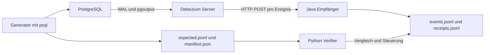

# Debezium-Versuechsufbau für Entwickler

[Deutsch](entwicklerleitfaden-de.md)

Für Cyrille. Stand: 11. Oktober 2026.

Dr Versuechsufbau untersucht PostgreSQL → Debezium Server → HTTP-Empfänger: Weli Zeileänderige chöme aa, was steit i de Nachrichte, und wie geit's nach emene Usfall wyter? Die vorhandene Tests liefere derfür e Usgangspunkt. Für Ussage über Produktionslaste bruucht's eigeti Mässige.

## Ufbau und Installation



Es git ke Kafka-Broker. Debezium Server betreibt dr PostgreSQL-Connector als ibetteti Engine und verwendet direkt e HTTP-Sink. Dr Ufbau enthaltet o ke Oracle- oder PeopleSoft-Komponente. Oracle Linux 8 bezeichnet hie ds Betriebssystem vo mene mögliche Zielhost, nid d Quelldatebank.

`make up` baut zersch dr Empfänger und startet dernah drü Dienscht. Dr Docker-Build verwendet Maven, kompiliert Java 25, füehrt die sechs Empfängertests us und erstellt ds Runtime-Image. Java und Maven müesse drum nid uf em Host installiert si. Bim erschte Build bruucht's Images und Maven-Abhängigkeiten us em Internet.

| Dienscht | Funktion | Zuestand und Zuegriff |
|---|---|---|
| `postgres` | Quelldatebank `appdb`, logische Replikation mit `pgoutput` | Volume `dbzproof_pg_data`; Hostport 5432 |
| `debezium` | Initiale Snapshot, dernah WAL-basierte Änderigserfassig und HTTP-Zuestellig | Volume `dbzproof_debezium_data` für `offsets.dat`; Health uf Hostport 8081 |
| `receiver` | `POST /events`, `GET /health`; Speichere und Empfangsdiagnostik | Bind-Mount `logs/`; Hostport 8080 |
| `generator` | Manuell gstartets SQL-Szenario; schribt Erwartige und Manifest | Compose-Profil `tools`; Bind-Mount `runs/` |

Alli veröffentlichte Ports si a `127.0.0.1` bunde. D Zuegangsdate `dbz` / `dbz` si lokali Demonstrationsdate mit Superuser-Rächt. HTTP het weder TLS no Authentifizierig. Für dä Versuech längt das. Für es produktivs System wär's z wenig.

Bim **erschte Start vo nere lääre Datebank** füehrt ds PostgreSQL-Image d Dateie i `postgres/init/` us:

1. `10-schema.sql` erstellt d Schemas `timecritical` und `bulk`, Tabelle, Schlüssel und Främdschlüssel. Die drü erfasste Tabelle überchöme `REPLICA IDENTITY FULL`.
2. `20-seed.sql` legt 3 Chunde, 4 Bstellige und 8 Bstellpositione sowie separati Bulk-Date aa.
3. `30-replication.sql` erstellt `dbz_publication` für die drü Tabelle im Schema `timecritical`.

PostgreSQL startet mit `wal_level=logical`. Debezium verwendet dr Slot `dbz_slot`, d Publication `dbz_publication`, e Schema- und e Tabellefilter. Änderige im Schema `bulk` si usgschlosse. Mit `snapshot.mode=initial` wärde zersch die vorhandene erfasste Zeile gläse; dernah louft d Erfassig us em WAL wyter. Dr Slot bhaltet d WAL-Historie, wo si Konsument bruucht. Bi längerem Stillstand cha die Retention entsprechend Platteplatz beanspruche.

D SQL-Initialisierig louft bi mene normale Neustart **nid nomau**. Änderige a `postgres/init/` verändere drum e bereits bestehendi Datebank nid automatisch.

## Start und reproduzierbari Usgangslag

Uf emene verbundene Linux-Host beziehungsweise i WSL bruucht's Docker CE, es Compose-Plugin mit `up --wait`, Bash, Make, curl und Python 3.12. Dr Verifier verwendet nume d Python-Standardbibliothek. Ds usfüehrende Konto muess Docker ohni es zuesätzlechs `sudo` ufrüefe chönne.

Alli folgende Befähl loufe im Repository-Verzeichnis:

```sh
sed -i "s/^HOST_UID=.*/HOST_UID=$(id -u)/" .env
sed -i "s/^HOST_GID=.*/HOST_GID=$(id -g)/" .env
docker compose --profile tools config --quiet
make up
make health
make verify
```

`logs/` und `runs/` müesse für die UID/GID beschribbar si. D Ports 5432, 8080 und 8081 müesse frei si. D Versionspins stöh i `.env`.

Für e erneute vollständige Test mit derselbe Snapshot-Fixture bruucht's e lääri Datebank, lääri Offsets und frische Logs. Vorhär gwünschti Beleg usserhalb vo `logs/` und `runs/` sichere:

```sh
# DESTRUKTIV: löscht nur den Zustand dieses Compose-Projekts.
make reset
make up
make verify
```

`make reset` entfernt Container, d Volumes `dbzproof_pg_data` und `dbzproof_debezium_data`, die drü benannte Logdateie und dr Inhalt vo `runs/` usser `.gitkeep`. `make stop`, `make restart` und `make down` bhalte Datebank und Offsets. Nume Logs lösche verursacht ke neue Snapshot; nume eis vo de beide Volumes zrüggsetze git e anderi Versuechsanordnig.

Dr vollständige Verifier schribt Date, stoppt dr Empfänger und startet Dienscht neu. Er blibt auso nid höflech am Rand stah. Nume uf emene isolierte Testufbau usfüehre. Ke parallele Verifier oder manuelli Szenarie starte: Si teile Datebank, Logs und Container; automatisch erzeugti IDs und Reportnäme hei Sekundeuflösig.

Für es Ziel ohni Internet gälte die separate Awysige i [Oracle Linux 8 offline](oracle-linux-8-offline-sg.md). Dört wird dr fertigi Empfänger als Image übertrage und ohni Build oder Pull gstartet. `make up` isch derfür ungeeignet, wüu's immer dr Build aastosst.

## Nachrichte und Beleg

`logs/events.jsonl` enthaltet eini JSON-Nachricht pro Zeile. Dr Empfänger parst ds JSON und serialisiert's kompakt neu; Inhalt und Struktur blibe erhalte, die ursprüngleche HTTP-Bytes und ihri Formatierig nid. Er aggregiert ke Transaktione und entfernt weder `before` no `after`.

| Fäld | Bedütig im Versuech |
|---|---|
| `op` | `r` für Snapshot, `c` für Insert, `u` für Update, `d` für Delete |
| `before`, `after` | Zeilebilder; bi Insert `before=null`, bi Delete `after=null` |
| `source` | Under anderem Schema, Tabelle, LSN, `txId`, Quellzyt und Snapshot-Markierig |
| `transaction` | Falls glieferet, Transaktionsmetadate; dr aktuelli Test verwendet `source.txId` |
| Zytstämpel | Grundlag für lokali Beobachtige vo dr Zuestellzyt |

`REPLICA IDENTITY FULL` ermöglicht alti Spaltewärt für Updates und Deletes. Dr Verifier prüeft usgwählti erwarteti Wärt, nid automatisch jedi Spalte. JSON-Schema-Metadate und zuesätzlechi Delete-Tombstones si abgschaltet; Delete-Envelopes wärde gliich glieferet.

Dr Empfänger schribt jedes Ereignis mit `FileChannel.force(true)`, bevor er HTTP 200 schickt. Schribfähler vo dr Ereignisdatei gäbe HTTP 500. Das haltet dr Empfänger eifach, choschtet aber Durchsatz. Ds HTTP-Protokoll wird dadruch nid atomar: Geit d Antwort nach erfolgreichem Schribe verlore, cha derselbi Event nomau iiträffe.

`logs/receipts.jsonl` protokolliert Status, Header, Body-Längi, Ereigniszämefassig und `received_at`; dä Zytstämpel entsteit bim Schribe vom Receipt nach em Ereignisschribe. Receipt-Schribfähler wärde diagnostiziert, verhindere aber nid automatisch HTTP 200. Ereignisdatei, Receipt-Datei und Connector-Offset bilde ke gmeinsami Transaktion. `logs/receiver.log` enthaltet d Empfängerdiagnostik.

Für jede Generatorlouf entstöh `runs/<RUN_ID>/expected.jsonl` und `manifest.json`. D Erwartige chöme us de vorgäbene SQL-Operatione und de zrügggäbene IDs, nid us de empfangene Nachrichte. Bestehendi Loufverzeichnis wärde abgwise; pro Versuech e neui `RUN_ID` verwände.

## Was d Tests prüefe

### Empfängertests im Build

Die sechs JUnit-Tests i `ReceiverTest.java` prüefe:

- Erhalt vo mene gültige JSON-Envelope und sim Receipt-Summary.
- Lääri beziehungsweise `null`-Bodies: HTTP 204, ke Ereignisiitrag.
- Ungültigs JSON: HTTP 400 und Fähler-Receipt.
- Fähler bim Ereignisschribe: HTTP 500.
- 20 paralleli POSTs: 20 parsebari Ereigniszeile und lückelosi Receipt-Sequenze.
- Health-Antwort mit HTTP 200 und `status=UP`.

Das si Tests vom HTTP-Empfänger, ke Connector-Tests. D Parallelitätsprüefig bewiist insbesondere ke eindeutigi Zueordnig zwüsche dr Reihefolg vo de beide Dateie bi beliebige parallele Clients.

### Integrationstests

`python3 verify/verify.py all` füehrt sibe Einzelprüefige us. Die ursprüngleche acht Abnahmekriterie si dadruch abdeckt, dass `scenario` Zeilematching und Transaktionszueordnig zäme prüeft.

| Befähl | Aktion und Erfolgskriterium |
|---|---|
| `health` | Beidi HTTP-Health-Endpünkt liefere 200, Empfängerstatus isch `UP`, letschti Ereigniszeile isch JSON. Dr Check wartet nid uf dr erscht Event. |
| `snapshot` | Wartet uf d Seed-Events mit `op=r`, prüeft d Snapshot-Markierige und exakt 3/4/8 Events für die drü Fixture-Tabelle. |
| `scenario` | Erzeugt e neue Louf, wartet uf sibe passendi Events, prüeft erwarteti Before-/After-Wärt und genau vier T1-Matches mit gmeinsamer, nid lääre `source.txId`. |
| `bulk --run-id=…` | Prüeft e bestehende Louf: e Bulk-Job, zwöi Pending-Zeile, dervo eini verarbeitet. Aktualisiert Bulk und dernah e erfasste Chund als Fortschrittsmarker; es dörfe ke Bulk-Envelopes vorcho. |
| `outage-short` | Stoppt dr Empfänger, erzeugt Änderige, wartet nach dr Generierig zäh Sekunde und startet ne wieder. Erwarteti Events müesse iiträffe; Debezium muess bi de Zuestandsabfrage düregehend loufe. |
| `outage-long` | Stoppt dr Empfänger bis zum beobachtete Engine-/Health-Fähler, sammlet Logs, stellt dr Empfänger wieder här und startet Debezium explizit neu. Wartet uf gsundi Dienscht und die erwartete Backlog-Events. |
| `restart` | Erzeugt Date vor und nach emene Stack-Neustart. Prüeft usgwählti persistierti Zeile, Zuestellig und unveränderti Snapshot-Aazahl. |

Ds Standardszenario besteit us vier Inserts i **einer** Transaktion T1: Chund, Bstellig, zwöi Positione. Derna folge es Chunde-Update, es Bstelligs-Update und es Positions-Delete als drü wyteri Transaktione. Zuesätzlech wärde drü Bulk-Zeile aagleit und eini dervo aktualisiert. Es si sibe erwarteti erfassti Zeileänderige, ke einzigi aggregierti Bstelligsnachricht.

`scenario --run-id=…` **füehrt dr Generator us**. Es validiert ke bereits manuell erzeugte Louf. `bulk --run-id=…` list dergäge e bestehende Louf. Bispiel:

```sh
python3 verify/verify.py scenario --run-id=cyrille-001
python3 verify/verify.py bulk --run-id=cyrille-001
```

Jede Ufruef schribt e JSON-Report under `runs/verify-<UTC-Zeit>.json`; Exitcode 0 bedütet Erfolg, 1 Fähler. D Reportfälder `checks.*.passed` und `evidence` zeige Ergebnis und Beleg. Loufverzeichnis und Logs si vo Git usgschlosse und chöme bim Klone nid mit.

## Was d Ergebnis zeige

Dr lokal vorhandeni vollständigi Report `runs/verify-20261011T155040Z.json` enthaltet die folgende Ergebnis. Er het am 11. Oktober 2026 um 15:49:28 UTC aagfange und isch um 15:50:40 UTC fertig gsi.

| Beobachtig | Ergebnis |
|---|---|
| Einzelprüefige | Alli sibe `passed=true` |
| Initiale Snapshot | 3 Chunde, 4 Bstellige, 8 Positione |
| Standardszenario | 7/7 erwarteti Events; vier T1-Envelopes mit gmeinsamer `txId=787` |
| Bulk-Usschluss | Erwarteti Bulk-Zeile vorhanden; ke Bulk-Event beobachtet |
| Churze Usfall | Zuestellig wiederhärgstellt nach 15,2 s ab Testbeginn; Debezium isch bi de Abfrage loufend blibe |
| Lange Usfall | 10 protokollierti fählgschlagni Sändversüech; Fählerzuestand nach 34,9 s; Container isch wytergloufe, Health isch DOWN gsi; Wiederhärstellig dür explizite Neustart |
| Gwöhnleche Neustart | Prüefti Date erhalte; Snapshot-Aazahl 15 → 15 |
| Duplikate | Bi de Prüefige, wo Duplikate uswärte, keni beobachtet |
| Lokali Zuestellzyt | Sibe Samples: Minimum 820,0 ms, Median 842,3 ms, Maximum 852,3 ms |

Dr dokumentierti Louf vom 9. Oktober het ebenfalls erfüllti Abnahmekriterie zeigt, öppe 39 s bis zum Fählerzuestand bim lange Usfall und Zuestellzyte vo 589/602/611 ms. So hei die Löif usgseh. Drus folgt no ke zuegsichereti Gränze.

D aktuelli Konfiguration setzt 5000 ms HTTP-Timeout, 10 Retries und 3000 ms Retry-Intervall. Verbindigsablehnige, Timeouts und d Logzählig erloube ke garantierte Usfallduur dür eifachi Multiplikation. Massgäbend si d gmässni Duur, Health und Engine-Logs.

### Gränze vo dr Ussagechraft

Es PASS bedütet: Die jeweiligi Assertion isch erfüllt worde. Meh behauptet dr Test nid. Dr Long-Outage-Test akzeptiert zum Bispiel e beobachtete Health-/Container-Fählerzuestand; er zeichnet Engine-Fählerzeile uf, verlangt ihres Vorhandesi aber nid als separati Assertion. Dr Short-Outage-Test beobachtet Containerzueständ und erfolgreichi Zuestellig, ke lückelosi interni Engine-Historie. Für anderi Fählerbilder d Assertions entsprechend verschärfe.

Ds Matching vergliicht Operation, Schema, Tabelle, `id` und konfigurierti Spaltewärt. Es bewiist ke globali Reihefolg, vollständigi Fäldgliichheit oder atomari Verarbeitig vo nere Transaktion dür dr Empfänger. D Dubletteheuristik verwendet `(LSN, Schema, Tabelle, Operation, id)`; einigi Prüefige protokolliere Dublette, ohni deswäge fählzschlah. T1 verlangt dergäge genau vier Matches.

D Zytmässig vergliicht `source.ts_ms` mit em Receipt-Zytstämpel. Si umfasst dämnach o lokali Verarbeitig und Dateischribe; si isch ke reini Netzwerklatenz. D Zueordnig erfolgt über d Position vo dr Ereigniszeile und de Event-Receipts. Für zuesätzlechi paralleli HTTP-Clients oder verteilti Hosts bruucht's e expliziti Korrelation und synchronisierti Uhre.

Nid belegt si Exactly-once, duurhafti Verlustfreiheit bi beliebige Crash-Zytpünkt, höchi Last, Langzytstabilität, Hochverfügbarkeit oder ds Verhalte vo andere Datebank-Connectoren. Wär das wott wüsse, muess es gezielt teste.

## Eigeti Tests ergänze

### Änderige am Standardszenario

`generator/generate.sh` enthaltet sowohl SQL als o die unabhängige Erwartige. Für e zuesätzlechi Änderig:

1. SQL-Operation mit eindeutigem Loufmarker derzuefüege und erzeugti IDs per `RETURNING` übernäh.
2. Passendi Erwartig mit `seq`, `tx`, `op`, `schema`, `table`, `key`, `before` und `after` ergänze. Vorhär- und Nachhärwärt us em Szenario ableite.
3. `timecritical_events_expected` im Manifest apasse. Ds Manifestfäld isch Dokumentation; die vorhandeni Szenarioprüefig zählt die gladene Erwartige.
4. `Verifier.scenario()` apasse, falls T1 nüm genau vier Events enthaltet. Die Zahl isch zurzyt fescht codiert.
5. Bi veränderte Seed-Date o `postgres/expected_snapshot.json` aktualisiere und e neui Usgangslag härstelle.

E zuesätzleche `u`-Event usserhalb T1 cha mit derselbe Matching-Logik prüeft wärde. Wyteri Transaktione wärde nid automatisch uf gmeinsami oder unterschiedlechi `txId` prüeft; derfür e expliziti Assertion ergänze. `seq` isch e Erwartigsnummer, ke zurzyt prüefti Lieferreihefolg.

### Eigenständigs Rollback-Experiment

Ds folgende Experiment chunnt ohni Änderige am Standardgenerator us. Vorussetzig isch e gsunde Stack ohni paralleli Writer. Bi nere Wiederholig beidi Marker ändere; si si einmalig.

```sh
docker compose exec -T postgres psql -X -v ON_ERROR_STOP=1 -U dbz -d appdb <<'SQL'
BEGIN;
INSERT INTO timecritical.customers (external_ref, name, email)
VALUES ('rollback-cyrille-001', 'Rollback', 'rollback@example.test');
ROLLBACK;

INSERT INTO timecritical.customers (external_ref, name, email)
VALUES ('commit-cyrille-001', 'Commit marker', 'commit@example.test');
SQL

python3 - <<'PY'
import json
import time
from pathlib import Path

deadline = time.monotonic() + 60
while True:
    events = []
    for line in Path('logs/events.jsonl').read_text().splitlines():
        try:
            events.append(json.loads(line))
        except json.JSONDecodeError:
            continue  # Eine gerade geschriebene letzte Zeile kann unvollständig sein.
    refs = {
        (e.get('after') or {}).get('external_ref')
        for e in events
        if e.get('op') == 'c'
        and (e.get('source') or {}).get('schema') == 'timecritical'
        and (e.get('source') or {}).get('table') == 'customers'
    }
    if 'commit-cyrille-001' in refs:
        if 'rollback-cyrille-001' in refs:
            raise SystemExit('FAIL: zurückgerollte Zeile wurde zugestellt')
        print('PASS: Commit-Marker zugestellt, Rollback-Zeile nicht beobachtet')
        break
    if time.monotonic() >= deadline:
        raise SystemExit('FAIL: Commit-Marker nach 60 s nicht zugestellt')
    time.sleep(0.5)
PY
```

Dr nachfolgende Commit-Marker liefert e positive Fortschrittsbeleg, statt nach ere beliebige Pause nume ds Fähle vo nere Nachricht feschtzstelle. Dr Test prüeft die under dere Konfiguration beobachteti Zuestellig bis zum Marker. Für e duurhafte Test d Logik als eigene Check i `verify/verify.py` ufnäh, Fähler über `note()` mälde und im CLI sowie falls nötig i `all` registriere.

### Tabelle, Capture-Filter und Datemodell

Für e wyteri erfassti Tabelle müesse Datebank und Connector zämepasse:

- Tabelle und Schlüssel erstelle; für vollständigi alti Zeilebilder `REPLICA IDENTITY FULL` setze.
- Tabelle i `dbz_publication` ufnäh.
- `debezium.source.table.include.list` erwytere; bi mene neue Schema o `schema.include.list`.
- Erwartigsdate, Snapshot-Fixture und betroffeni Prüefige erwytere.

Bi nere bestehende Datebank SQL direkt awände oder e expliziti Migration usfüehre. Nume e Init-Datei bearbeite längt nid. Nach ere Änderig a `application.properties` Debezium mit `make recover` neu starte. E neu ufgnohni Tabelle wird dadruch nid automatisch vollständig nachglade: Für dr Vergliich vo ihre bestehende Zeile e neue Initial-Snapshot uf emene wägwärfbare Ufbau vorseh oder e separate Snapshot-Test gstalte.

Bi zämegsetzte beziehungsweise andere Primärschlüssel die zurzyt uf `id` feschtgleite Funktione `match()`, `mismatch_reason()` und `duplicates()` apasse. Es HTTP-Ziel mit eigeter Persistenz muess wyterhin zuverlässig bestätige, ob's dr Event übernoh het.

### Wyteri sinnvolli Experiment

| Fragestellig | Änderig | Zuesätzleche Nachwies |
|---|---|---|
| Rollback und langi Transaktione | Commit verzögere, Transaktion zrüggrolle | Ke Event vor Commit; ke Rollback-Event; anschliessende Fortschrittsmarker |
| Mehreri Updates vo derselbe Zeile | Mehreri Zuestandswächsel i einer und i mehrere Transaktione | Zwüschezueständ, Reihefolg und Transaktionszueordnig gezielt prüefe |
| HTTP 500, Timeout, langsami Antwort | Empfänger um gezielti Fählerfäll erwytere | Versüech, Gsundheitszuestand, Recovery und Dublette korreliere |
| Antwortverlust nach erfolgreichem Schribe | Fähler zwüsche Persistierig und HTTP-Antwort injiziere | Gliichi Quellposition mehfach erkenne; Idempotenz vom Zielsystem prüefe |
| Crash und Wiederalouf | Prozess a definierte Stelle abbräche | Erwarteti Quellpositione vor/nach Crash, persistierti Offsets und Zielzuestand vergliiche |
| Durchsatz und Backpressure | Datemängi erhöhe; Ressource und Sink ändere | Latenzverteilig, Durchsatz, Queue-/WAL-Wachstum, CPU, Speicher und Disk-I/O mässe |
| DDL und Schemaänderige | Spalte derzuefüege, ändere oder entferne | Envelope-Form, Decoderverhalte und Verarbeitig im Ziel prüefe |

HTTP-Batching isch zurzyt deaktiviert. Eifachs Iischalte verändert dr Payload-Vertrag; Empfänger, Logformat und Verifier müesse de uf die tatsächlechi Batch-Repräsentation apasst wärde. Ebenso si Credentials und Hostports nid düregehend parametrisiert: `.env`, Connector-Konfiguration, Makefile und Verifier enthalte teilweise dieselbe Wärt als Literale und müesse zäme gänderet wärde.

Für grössere Lasttests list dr aktuelli Verifier wiederholt die ganzi Ereignisdatei und suecht Matches verschachtlet. Für chlyni Funktionsprobe längt das. Für belastbari Mässige inkrementell läse, nach Ereignisidentität indexiere und d Mässig vom Prüefufwand trenne. Die beide Named Volumes und d Container hei feschti Näme; es zwöits Checkout uf demselbe Docker-Daemon isch drum ohni Apassige ke unabhängige Testufbau.

## Relevanti Dateie

| Datei | Änderigsbereich |
|---|---|
| `compose.yaml`, `.env`, `Makefile` | Dienscht, Versione, Ressource, Bind-Mounts und Bedienig |
| `postgres/init/*.sql` | Datemodell, Seed und Publication |
| `postgres/expected_snapshot.json` | Erwarteti Seed-Snapshot-Aazahle |
| `debezium/application.properties` | Connector, Filter, Snapshot, HTTP-Sink und Retry-Budget |
| `generator/generate.sh` | SQL-Szenario, Soll-Events und Loufmanifest |
| `receiver/src/main/java/ch/jclk/dbzproof/receiver/Receiver.java` | HTTP-Verhalte, Persistierig und Fähler-Injektion |
| `receiver/src/test/java/ch/jclk/dbzproof/receiver/ReceiverTest.java` | Empfängertests |
| `verify/verify.py` | Matching, Assertions, Recovery, Reports und CLI |

Wyteri Betriebsdetails stöh im [Operator Guide](operator-guide-sg.md), Details zur HTTP-Repräsentation i [debezium/README.md](../debezium/README.md).
